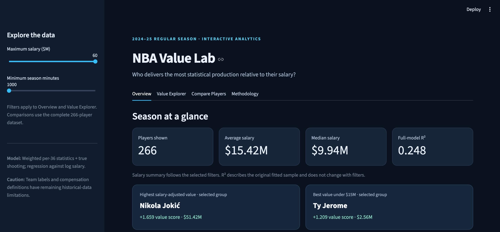

# NBA Value Lab

**An interactive analysis of NBA player production and 2024–25 salaries.**

NBA Value Lab explores one question: **Which players produced more box-score value than expected for their reported 2024–25 salary?** It combines NBA regular-season statistics, salary data, a transparent weighted production score, and a descriptive salary-adjusted regression in an interactive Streamlit dashboard.

**[Live dashboard — add URL after deployment](https://share.streamlit.io/)** · [Methodology](#methodology) · [Run locally](#run-locally)



## Features

- Explore salary versus production with an interactive scatter plot and expected-production curve.
- Browse overall and under-$15M value leaderboards.
- Filter by maximum salary and minimum season minutes.
- Compare two players' salaries, rankings, and box-score production.
- Export filtered rankings as CSV.

## Project at a glance

| Measure | Result |
| --- | ---: |
| Season | 2024–25 regular season |
| NBA player records collected | 569 |
| Players in primary model | 266 |
| Minimum estimated season minutes | 1,000 |
| Salary regression R² (in-sample) | 0.2481 |
| Highest overall value score | Nikola Jokić (+1.659) |
| Highest value score under $15M | Ty Jerome (+1.209) |

The reported scores describe performance relative to this model and **are not estimates of a player's dollar value, total on-court impact, or future performance**.

## Technologies

Python, Pandas, NumPy, scikit-learn, Plotly, Streamlit, Jupyter Notebook, Git/GitHub.

## Analysis workflow

1. **Data collection:** Gather regular-season NBA player statistics with [`nba_api`](https://github.com/swar/nba_api).
2. **Data cleaning:** Inspect duplicates and missing values, standardize names, review team discrepancies, and merge salary data.
3. **Exploratory analysis:** Explore salary distribution, scoring/efficiency relationships, and outliers.
4. **Value model:** Calculate weighted standardized production and compare it with salary-based expectations.
5. **Interactive app:** Present rankings, filters, visualizations, and player comparisons in Streamlit.

The notebooks are organized as `01_data_collection.ipynb`, `02_data_cleaning.ipynb`, `03_exploratory_analysis.ipynb`, and `04_player_value_model.ipynb` under `notebooks/`.

## Methodology

Players need at least **approximately 1,000 minutes** during the 2024–25 regular season. We estimate season minutes from games played and rounded minutes per game; an exact-minutes source would improve this cutoff.

Five per-36-minute rate statistics and true shooting percentage are standardized as z-scores over the original eligible sample. The production score is a weighted combination:

| Component | Weight |
| --- | ---: |
| Points per 36 | 30% |
| Assists per 36 | 20% |
| Rebounds per 36 | 15% |
| Steals per 36 | 10% |
| Blocks per 36 | 5% |
| True shooting percentage | 20% |

To screen potentially non-comparable partial-season compensation, the primary model temporarily excludes four salary entries below $1 million; this is a **screening heuristic**, not proof those contracts are incorrectly reported. We retain the original standardized production scores and refit a descriptive linear regression on the remaining 266 players:

`Expected production = intercept + coefficient × ln(salary in $ millions)`

`Value score = actual production score − expected production score`

The fitted intercept is approximately **−0.6074**, and the coefficient is approximately **0.2678**. The in-sample R² is **0.2481**. The actual dashboard derives its regression curve from the exported expected-production values rather than rounded coefficients.

## Selected findings

- Salary and points per game were positively correlated in the broader 270-player exploratory sample (Pearson **r = 0.705**).
- The initial sample's average salary was **$15.20M**, compared with a median of **$9.83M**.
- The overall value model ranked Nikola Jokić first; among players earning under $15M, Ty Jerome ranked first.
- The top three overall value scores persisted when minimum playing time was raised to 1,500 and 2,000 minutes (holding the originally fitted model fixed).

## Limitations

- A player’s salary reflects contract rules, timing, negotiations, and roster decisions—not simply that season’s statistical performance.
- The weighted production score is subjective, and box-score metrics miss many defensive and off-ball contributions.
- Per-36 statistics can overstate what lower-minute players could sustain over longer workloads.
- The regression is **descriptive and in-sample**, not an out-of-sample prediction or causal analysis.
- The salary source includes contract records that may not share a uniform full-season definition. A sub-$1M screen reduces one obvious problem without completely solving it.
- Historical team labels have not been fully audited and should not be treated as definitive 2024–25 team assignments.
- The analysis is restricted to the 2024–25 regular season.

## Data and attribution

- NBA statistics: [`nba_api`](https://github.com/swar/nba_api), retrieving NBA statistical endpoints.
- Salary input: [`edwinjeon/NBA-Salary-Prediction`](https://github.com/edwinjeon/NBA-Salary-Prediction), `NBA Player Salaries_2024-25_1.csv`.

**Redistribution notice:** Redistribution rights for the source salary CSV and the derivative merged CSV have not yet been confirmed. Do not publicly commit these CSVs until the relevant permissions are verified or the data has been replaced with a properly reusable source. The project may be deployed with approved data once that verification is complete.

## Run locally

Requires Python 3.12 (recommended).

```bash
python3 -m venv .venv
source .venv/bin/activate
python -m pip install -r requirements.txt
python -m streamlit run app.py
```

The application expects `data/processed/nba_dashboard_data.csv` generated by Notebook 04 (or supplied from a permitted source). If that file is absent, the app displays an explanatory error. The public deployment requires this file or an authorized alternative to be available.

## Project status

- [x] NBA statistical collection and cleaning
- [x] Exploratory analysis
- [x] Weighted value model and sensitivity checks
- [x] Interactive Streamlit dashboard
- [ ] Data redistribution verification
- [ ] Public Streamlit deployment

This is an independent educational analytics project, not an official NBA product.
